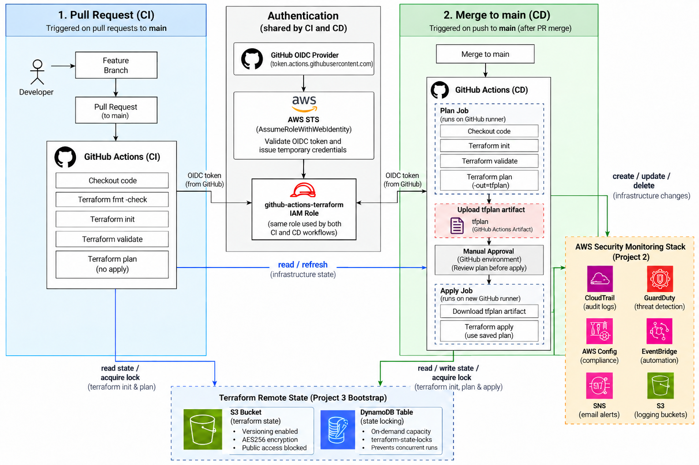

# Terraform CI/CD for AWS Security Monitoring

## Business Scenario

In Project 2, I built the AWS security monitoring environment with Terraform, but I was still running Terraform locally from my laptop.

That works for learning, but it is not how I would want infrastructure changes handled in a real environment. I wanted a process where changes could be reviewed first, checked automatically, authenticated securely, and only deployed after approval.

This project adds that delivery process around the security monitoring stack using GitHub Actions, Terraform remote state, GitHub OIDC, and a production approval gate.

## Project Goal

This is the follow-up to my security monitoring project. That project built the infrastructure. This one automates how it gets deployed.

I used remote Terraform state, GitHub OIDC authentication, and GitHub Actions to validate and deploy the Project 2 Terraform without storing any long-lived AWS credentials in GitHub.

The infrastructure itself is mostly the same. The work in this project is focused on how changes reach AWS safely and consistently.

## Project Status

- Remote Terraform state configured in Amazon S3
- State locking configured with DynamoDB
- Project 2 state migrated from local to remote state
- GitHub OIDC provider configured in AWS
- GitHub Actions Terraform IAM role created
- CI workflow created for format, validation, and plan checks
- CD workflow created for production deployment
- Production approval gate configured
- Saved Terraform plan artifact added
- OIDC trust policy tightened to specific GitHub subjects
- CI concurrency and Terraform lock timeout added
- Existing AWS resources reconciled with Terraform state
- Production deployment completed successfully through GitHub Actions
- Final Terraform plan returned no changes

## Tools and Services Used

- Terraform
- GitHub Actions
- AWS IAM
- GitHub OIDC
- AWS STS
- Amazon S3
- Amazon DynamoDB
- GitHub Environments
- GitHub branch protection

## Architecture Overview

There are three main parts to this project: where Terraform state lives, how GitHub authenticates to AWS, and what happens when infrastructure code changes.

Terraform state was originally stored on my laptop. That works for local testing, but GitHub Actions runners are temporary machines. A new runner starts for each workflow run and does not have access to a local state file on my computer.

I moved the state to an S3 backend so both local Terraform and GitHub Actions can work from the same source of truth. The state bucket has versioning, encryption, and public access blocking enabled. A DynamoDB table is used for state locking so multiple Terraform operations do not try to modify the same state at once.

For authentication, I used GitHub OIDC instead of storing AWS access keys as GitHub secrets. GitHub Actions requests a short-lived identity token, AWS STS validates it, and the workflow assumes an IAM role with temporary credentials.

The workflow is split between CI and CD.

```text
Feature branch
      |
      v
Pull request
      |
      v
CI: fmt-check / init / validate / plan
      |
      v
Review and merge
      |
      v
CD: plan --> saved tfplan artifact
      |
      v
Production approval
      |
      v
CD: apply saved plan
```

The goal is to separate proposing a change from actually deploying it.

## Architecture Diagram



## Remote State Backend

The remote backend is created from a separate Terraform configuration in `03-terraform-cicd/bootstrap/`.

I kept the backend resources separate because Terraform cannot create an S3 bucket and use that same bucket as its remote backend during the first run. The backend has to exist before Terraform can store state in it.

The bootstrap configuration creates:

- An S3 bucket for Terraform state
- S3 versioning
- Server-side encryption
- Public access blocking
- A DynamoDB table for Terraform state locking

The state bucket is shared by multiple Terraform configurations, but each one uses a different state key.

Project 2 uses `security-monitoring/terraform.tfstate`.

The OIDC configuration uses `cicd-oidc/terraform.tfstate`.

That keeps the state files separate even though they are stored in the same S3 bucket.

## GitHub OIDC Authentication

One of the main goals of this project was avoiding long-lived AWS access keys in GitHub.

Instead of creating an IAM user and storing an access key and secret key as GitHub secrets, I registered GitHub's token service as an OIDC identity provider in AWS.

```text
GitHub Actions
      |
      | OIDC token
      v
AWS STS
      |
      | temporary credentials
      v
github-actions-terraform IAM role
```

The credentials only exist for the workflow session.

The IAM trust policy also limits which GitHub identities can assume the role.

The `aud` condition requires `sts.amazonaws.com`.

The `sub` condition is restricted to specific GitHub contexts:

```text
repo:PWabuthu/cloud-engineer-portfolio:ref:refs/heads/main
repo:PWabuthu/cloud-engineer-portfolio:environment:production
repo:PWabuthu/cloud-engineer-portfolio:pull_request
```

My first version used `repo:PWabuthu/cloud-engineer-portfolio:*`.

That limited access to my repository, but the wildcard still allowed any branch context in the repository to match.

I replaced that with exact subject values so the trust policy is more restrictive.

## CI Workflow

The CI workflow runs on pull requests that change the Project 2 Terraform configuration.

It performs `terraform fmt -check`, `terraform init`, `terraform validate`, and `terraform plan`.

CI does not apply infrastructure changes.

Its purpose is to answer whether the Terraform code is formatted correctly, validates successfully, can initialize against the real backend, and produces a valid plan.

I also added a concurrency group:

```yaml
concurrency:
  group: terraform-ci-security-monitoring
  cancel-in-progress: false
```

This prevents multiple CI runs for the same Terraform stack from running at the same time.

The plan command also uses `-lock-timeout=5m` so Terraform can wait for a temporary state lock instead of immediately failing.

## CD Workflow

The CD workflow runs after approved changes are merged into `main`.

It generates a Terraform plan, saves that plan as a `tfplan` artifact, and waits at the protected `production` environment before the apply job can continue.

After approval, the workflow downloads the saved artifact and applies that exact plan.

The CD plan also uses `-lock-timeout=5m` so a temporary state lock does not cause the deployment workflow to fail immediately.

## Applying the Plan That Was Approved

My first CD workflow had a problem that was easy to miss.

The plan job ran `terraform plan`, and then the apply job ran `terraform apply -auto-approve`.

That meant Terraform created a new plan during the apply step.

The approval gate was effectively approving one plan, while Terraform could generate and apply a different one afterward.

I changed the workflow to save the plan with `terraform plan -out=tfplan`, upload it as an artifact, and then apply that exact file with `terraform apply tfplan`.

That closed the gap between what was reviewed and what was actually deployed.

## IAM and Permissions

The GitHub Actions role needed enough permission to manage the Project 2 security monitoring infrastructure without simply attaching `AdministratorAccess`.

I scoped permissions to project resources wherever AWS supported resource-level permissions.

The policy includes access for resources such as:

- Terraform state in S3
- DynamoDB state locking
- Project 2 logging buckets
- CloudTrail
- GuardDuty
- AWS Config
- EventBridge
- SNS
- IAM resources required by AWS Config

For S3, Terraform's refresh process reads more bucket settings than I originally expected.

During testing I hit several `AccessDenied` errors for bucket configuration reads. Rather than continue adding individual read actions one at a time, I eventually used `s3:Get*` while keeping it scoped to the Project 2 bucket resources.

Some AWS API actions do not support useful resource-level ARN restrictions and still require `Resource = "*"`. I kept those permissions in separate statements rather than pretending the entire policy is fully resource-scoped.

## Design Decisions and Trade-Offs

**OIDC instead of AWS access keys**

The simpler setup would have been creating an IAM user and storing AWS access keys in GitHub Secrets.

I chose OIDC instead.

That required more setup, but it means GitHub does not hold a permanent AWS credential. The workflow receives temporary credentials when it assumes the IAM role.

**Remote state instead of local state**

Local state was fine while I was the only person running Terraform from one laptop.

Once GitHub Actions became part of the deployment process, local state stopped making sense.

Moving state to S3 gave both local Terraform and GitHub Actions access to the same state.

**Least privilege instead of AdministratorAccess**

Using `AdministratorAccess` would have made the pipeline much easier to build.

Instead, I worked through the permissions Terraform actually needed.

That created more troubleshooting work, but it gave me a much better understanding of how Terraform interacts with AWS during refresh, plan, and apply.

## Lessons Learned

### Terraform State Reconciliation

One of the harder parts of this project was getting Terraform state back in sync with resources that already existed in AWS.

During the migration and CI/CD work, Terraform reached a point where some resources existed in AWS but were either missing from state, represented differently in state, or marked as tainted.

That created plans where Terraform wanted to recreate resources that were already healthy.

Instead of immediately applying the plan, I compared Terraform state with the actual AWS environment.

I imported existing S3 configuration resources into state where necessary and cleared taints only after checking that the underlying AWS resources were healthy.

Some resources had also been created successfully during earlier partial applies even though the overall pipeline run failed later.

That taught me an important lesson: a failed Terraform apply does not always mean nothing changed.

Terraform can create several resources successfully and then fail on another resource. Before retrying, I need to check both the Terraform state and the live AWS environment.

The final validation was `terraform plan` returning `No changes. Your infrastructure matches the configuration.`

That confirmed the Terraform configuration, state, and AWS environment were aligned again.

### Permissions Took Several Rounds to Get Right

The GitHub Actions IAM policy was not correct on the first attempt.

Terraform does a refresh before planning, which means it needs read permissions for existing resource attributes in addition to the permissions needed to create or update them.

Several pipeline runs failed with `AccessDenied` errors.

Each failure showed me another AWS API call Terraform needed.

```text
Run pipeline
      |
      v
AccessDenied
      |
      v
Identify API action
      |
      v
Update IAM policy
      |
      v
Retry
```

That was slower than using an administrator policy, but it was much more useful from a learning standpoint.

### Local Terraform and CI Are Different Environments

Project 2 worked locally because I had a local `terraform.tfvars` file containing the alert email variable.

That file is intentionally excluded from Git.

When GitHub Actions ran Terraform, the runner did not have the file, so the plan failed.

I fixed that by storing the value in GitHub Secrets and passing it to Terraform as `TF_VAR_alert_email`.

That taught me that anything a local Terraform run depends on has to be made available explicitly to the CI environment.

### State Locks Are Not Pipeline Failures

Terraform state locking can initially look like something is broken.

If two operations use the same state at the same time, Terraform blocks one to protect the state.

I added GitHub Actions concurrency controls so CI runs queue instead of competing for the same state, and I added a Terraform lock timeout so short-lived locks do not cause immediate failures.

## How to Deploy

### 1. Bootstrap the Backend

From the repository root:

```bash
cd 03-terraform-cicd/bootstrap
terraform init
terraform plan
terraform apply
```

The outputs include the Terraform state bucket and lock table.

### 2. Configure the Project 2 Backend

Project 2 uses the S3 backend bucket `pwabuthu-terraform-state`, the state key `security-monitoring/terraform.tfstate`, and region `us-east-1`.

State locking uses the DynamoDB table `terraform-state-locks`.

### 3. Deploy the GitHub OIDC Configuration

```bash
cd 03-terraform-cicd/oidc
terraform init
terraform plan
terraform apply
```

This creates the GitHub OIDC provider and the IAM role used by GitHub Actions.

### 4. Configure GitHub

The repository requires:

- `TF_VAR_ALERT_EMAIL` GitHub secret
- `production` GitHub environment
- Required reviewer for the production environment
- Branch protection on `main`

After that, pull requests trigger CI and merges to `main` trigger CD.

## Validation

The pipeline was tested end to end.

The final successful workflow:

- authenticated to AWS through GitHub OIDC
- initialized the S3 remote backend
- acquired Terraform state locking
- refreshed existing AWS resources
- generated a Terraform plan
- saved the plan as an artifact
- stopped at the production approval gate
- downloaded the approved plan
- applied the saved Terraform plan
- created the remaining AWS Config rules
- completed the production deployment successfully

This successful run finished a stack that had already been partially applied during earlier troubleshooting. It was not a clean deployment from zero, which made state reconciliation and validation part of the recovery process.

After deployment, I checked the environment again locally with `terraform plan`.

Terraform returned `No changes. Your infrastructure matches the configuration.`

I also verified that CloudTrail was logging and AWS Config was recording successfully.

## What I'd Do Differently in Production

There are several improvements I would make before using this setup in a larger production environment.

**Separate CI and deployment roles**

Right now the CI and CD workflows use the same Terraform IAM role.

A stronger design would use a mostly read-only plan role for CI and a separate production deployment role with write permissions.

That would reduce the permissions available to pull request workflows.

**Add Terraform security scanning**

I would add a Terraform security scanner such as Checkov or tfsec to CI so risky infrastructure settings can be caught before review.

**Add scheduled drift detection**

The current workflow detects drift the next time Terraform plans.

A stronger setup would run a scheduled plan and alert when infrastructure changes outside Terraform.

**Strengthen IAM guardrails**

The deployment role has IAM permissions because Terraform manages the AWS Config service role.

In a shared production environment, I would add stronger controls around those permissions, such as a permissions boundary and tighter separation between infrastructure deployment roles.

**Improve plan visibility**

I would also publish the Terraform plan directly into the pull request so reviewers can inspect the proposed infrastructure changes without opening the GitHub Actions logs.

## Why I Built This

Projects 1 and 2 were mainly about building AWS infrastructure.

This project was different.

The infrastructure already existed. The problem was figuring out how to change it safely without relying on someone running Terraform manually from a laptop.

Building the pipeline forced me to work through remote state, state locking, short-lived AWS authentication, IAM permissions, CI/CD workflow behavior, partial Terraform applies, state reconciliation, and production approval controls.

The biggest lesson was that getting Terraform code to work is only one part of managing infrastructure.

How that code gets reviewed, authenticated, deployed, and recovered when something goes wrong matters just as much.